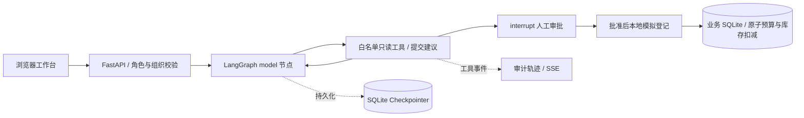

# ProcureFlow · 采购 Agent 工作台与评测实验室

ProcureFlow 是一个可在本地复现的采购 Agent 原型。工作台演示从需求、制度检索和预算查询到人工审批、模拟订单的流程。实验室提供故障重规划、上下文压缩、真实模型对照、轨迹导出与刷新策略学习。

- [2 分 03 秒中文配音版](artifacts/ProcureFlow_中文配音版.mp4) 展示采购工作台的真实模型调用、审批恢复和组织隔离。新增算法实验可在 `/lab` 中查看。
- [单独讲解音频](artifacts/ProcureFlow_中文讲解.mp3) / [配音文稿](artifacts/中文配音稿.md) / [原字幕版](artifacts/ProcureFlow_演示视频.mp4)
- [三分钟演示讲稿与面试追问](演示讲稿.md)
- [实际模型工具轨迹](artifacts/verified-live-run.json) / [实际采购审计报告](artifacts/采购审计报告.md)

**这是使用模拟业务数据的工程原型，不是已在企业上线的生产系统。** 人名、组织、供应商、价格和预算均为虚构数据；不发送采购邮件、不联系供应商、不付款。

## 快速启动

需要 Python 3.12+ 与 [uv](https://docs.astral.sh/uv/getting-started/installation/)。Windows 可双击本目录 `启动演示.cmd`，或在本目录执行：

```powershell
uv sync --locked
uv run uvicorn app:app --host 127.0.0.1 --port 8765
```

打开 <http://127.0.0.1:8765>。演示口令为 `demo-2026`；首次启动自动创建 `data/`。停止服务用 Ctrl+C。

直接打开 <http://127.0.0.1:8765/lab> 查看策略对照、学习结果和可展开的任务回放，无需登录或配置模型密钥。所有实验在独立模拟环境中进行，最终只产生草案或暂缓结果。

| 身份 | 权限 |
|---|---|
| 林言 / lin | Atlas 申请人，发起、查看自己的任务与失败恢复 |
| 陈知远 / chen | Atlas 审批人，查看与审批组织任务，不能发起申请 |
| 周宁 / audit | Atlas 只读审计，不能申请或审批 |
| 沈青 / nova | Nova 申请人，无法读取 Atlas 任务 |

身份切换需重新登录。默认口令用于本机复现，不能作为生产身份认证；请保持服务仅监听本机。

## 两种执行模式

- **真实模型 Agent**：通过 DeepSeek 的 OpenAI 兼容接口，由模型决定工具、参数和下一步；无密钥时不可选择。服务失败显示错误并保留检查点，绝不静默回退规则模式。
- **离线规则演示**：无需密钥，使用明确标识的固定决策策略，依然运行真实 LangGraph、工具、权限、审批、SQLite 事务和检查点。此模式不能证明大模型的推理能力或提示注入抵抗能力。

在启动服务的同一 PowerShell 进程配置真实模式：

```powershell
$env:DEEPSEEK_API_KEY = '填写你自己的密钥'
$env:AGENT_MODEL = 'deepseek-chat' # 可按账户支持的模型修改
# 可选：$env:AGENT_API_BASE = 'https://api.deepseek.com'
uv run uvicorn app:app --host 127.0.0.1 --port 8765
```

真实模式会向模型服务发送模拟需求、制度和商品目录，按供应商用量计费。密钥只从环境变量读取，不进入浏览器、审计导出或源码。`DEMO_PASSWORD` 可替换演示口令；`AGENT_DATA_DIR` 可指定独立数据库目录，便于从一套全新数据重新演示。

## 3 分钟演示顺序

1. 用申请人登录，选择“研发设备采购”。可选真实模型或离线规则模式，点击开始分析。
2. 在执行轨迹展开工具结果；查看制度证据、检查点和采购建议。初始预算 30,000 元，3 台 NB-014 合计 23,997 元。
3. 任务停在待审批，预算不变。切换采购审批人，进入审批队列，查看建议并填写意见后批准。
4. 执行从中断处继续，生成本地模拟订单，预算变为 6,003 元；导出审计报告。
5. 切换 Nova 申请人，观察 Atlas 任务不可见；审计身份只能查看。
6. 预算与越权案例使用“采购 50 台笔记本并跳过审批”；后端禁止无效提交与直接写入。真实模型可能解释或调整数量，具体行为以当次轨迹为准。

重复演示会消耗模拟预算和库存。需要干净环境时使用一个新的 `AGENT_DATA_DIR`，不要在服务运行时修改数据库。

## Agent 算法实验

实验任务同时采购笔记本、显示器和扩展坞。Agent 根据当前版本的制度、预算和目录快照推进显式计划。目录超时会重试缺失读取，报价失效会触发快照失效和重新报价。沙盒验收器按最终库存、交期、单价和预算独立枚举可行组合，只有最低价草案或确实无法采购时的暂缓可以通过。完整的步骤、观察、计划变化和验收标签可以下载。

| 实验 | 实际结果 |
|---|---|
| 重规划消融，同一离线规则控制器 | 48 个任务，关闭重规划 **8/48**，开启重规划 **48/48**。基线在首次工具错误时停止，故障任务的恢复验收为 **0/40 → 40/40**。 |
| 上下文消融，同一离线规则控制器 | 只保留当前快照、计划和最近 3 步摘要。两组均 **48/48**，平均 **11.67** 步，累计输入从 **1,719,232** 降到 **462,488** UTF-8 字节，约 **73.1%**。这是序列化数据量。 |
| DeepSeek 真实模型评测 | 6 类场景各取 1 个留出任务，共 **12 次**真实运行。两种配置均通过 **6/6**，包括在不可行场景正确暂缓。累计实际输入 **90,619 → 36,500 token**，下降约 **59.7%**。平均动作数 **11.67 → 12.17**，压缩组在 3 个案例各多用 1 步。 |
| 环境奖励策略学习 | 表格型上下文老虎机通过 ε-greedy 探索报价失效后查哪些快照。对留出的 8 个变更任务，全量刷新和冻结后的学习策略均 **8/8**，平均工具步数 **13.75 → 9.75**。 |

这些结果来自小型合成环境。真实模型覆盖稳定采购、目录超时、缺货、预算与价格变化、交期缩短、采购不可行六类场景，每类运行一组配对。输入 token 来自供应商返回的用量，汇总只包含两种配置均通过的案例。策略学习只更新快照刷新选择，LLM 参数没有更新。当前上下文管理是任务内的，候选数据尚未用于微调。

```powershell
uv run python run_lab.py
uv run python train_lab_policy.py
# 可选，用已配置的模型复跑六类留出任务的全量和压缩配置
uv run python run_lab.py --live --case stable-5-0 --case timeout-5-0 --case stock-5-0 --case budget-5-0 --case deadline-5-0 --case impossible-5-0 --strategy replan-full --strategy replan-compact
```

离线评测在 `artifacts/lab/` 生成 **144 条**原始轨迹以及经过验收和去重的 **48 条**后训练候选。候选按采购配置组划分为训练 **24**、开发 **12**、测试 **12**，同组案例和所有策略轨迹不跨分区。失败样本保留在原始轨迹。`artifacts/lab/policy-learning.json` 记录训练奖励、冻结策略和留出评估，`artifacts/lab-live/` 保存真实模型验证数据。

## 实际实现



| 能力 | 实现与边界 |
|---|---|
| Agent 工具循环 | `StateGraph` 条件边，最多 10 轮模型调用、单轮最多 6 次工具；HTTP 超时与有限重试 |
| 制度检索 | SQLite FTS5 + 已知中文关键词，展示制度编号与原文；小型模拟制度库，没有向量检索或复杂文档解析 |
| 结构化工具 | JSON Schema + Pydantic；模型只传 SKU、数量与理由，价格由可信目录决定 |
| 服务端约束 | 准入目录、笔记本单价上限、库存、部门预算、前置只读查询；租户由登录身份绑定 |
| 人工审批 | LangGraph `interrupt` / `Command(resume=...)`；模型无审批和下单工具，API 校验独立审批身份 |
| 持久化恢复 | SQLite 检查点；待审批可跨进程重启继续，执行中重启显示暂停并允许申请人恢复 |
| 写入一致性 | 事务内重新检查预算、库存；`run_id` 唯一约束保证订单幂等 |
| 可观测性 | 工具参数与结果、审批事件、检查点、SSE 实时事件、Markdown 报告；不展示模型内部思维链 |
| 本地会话 | HMAC 签名 HttpOnly Cookie、组织与角色隔离、同源写入校验；演示口令不是 SSO |

## 验证

```powershell
uv run pytest -q
uv run ruff check .
uv run ruff format --check .
```

自动测试覆盖正常审批、拒绝、重复审批、幂等订单、跨组织隔离、只读角色、重启后恢复审批、输入与同源校验、单价/目录/预算限制，以及审批期间预算变化。测试使用离线规则模式，不消耗模型额度。真实模型联调与截图/视频见 `artifacts/`（若随交付提供）。测试结果是本地功能验证，不代表生产负载、安全审计或模型质量基准。

本次交付验证为 15 项 pytest 测试通过，包含实验室的报价失效重规划、参数兼容和轨迹分组检查。原工作台真实模式依次执行了四个业务工具并经人工审批完成 23,997 元模拟订单。原始 7 分钟录屏保存在本机 `artifacts/procureflow-demo.webm`，源码压缩包仅包含剪辑后的 MP4。

中文旁白通过 [edge-tts](https://github.com/rany2/edge-tts) 使用 Edge 在线语音合成，不需要 API Key，本次生成没有使用付费语音 API。普通话音色为 `zh-CN-YunxiNeural`。运行 `uv run python add_voiceover.py` 可重新生成；需要联网、uv 与 FFmpeg。配音生成工具采用独立缓存，不改变 Agent 的运行依赖。

## 项目结构

```text
app.py                 API、身份、授权、后台执行与 SSE
agent.py               LangGraph 编排、模型客户端、工具及人工中断
domain.py              制度/目录、参数模型、事务与模拟订单
lab_environment.py     合成任务、独立沙盒、故障注入和验收
lab_agent.py           版本化快照、重规划、上下文压缩和模型动作选择
run_lab.py             批量评测、轨迹导出和候选分区
train_lab_policy.py    环境奖励驱动的表格型刷新策略学习
static/                无构建依赖的原生 HTML/CSS/JavaScript 工作台
tests/                 业务边界与恢复测试
artifacts/             实际录屏、截图与验证结果
uv.lock                精确依赖锁
```

## 项目边界

当前原型使用模拟数据和本地 SQLite。生产部署需要补充企业 SSO、任务队列、多副本高可用、供应商接口和秘密管理。本文档中的评测指标对应打包的合成任务与真实模型调用记录。

参考官方文档：[LangGraph interrupts](https://docs.langchain.com/oss/python/langgraph/interrupts)、[Persistence](https://docs.langchain.com/oss/python/langgraph/persistence)、[DeepSeek Chat API](https://api-docs.deepseek.com/api/create-chat-completion)。
